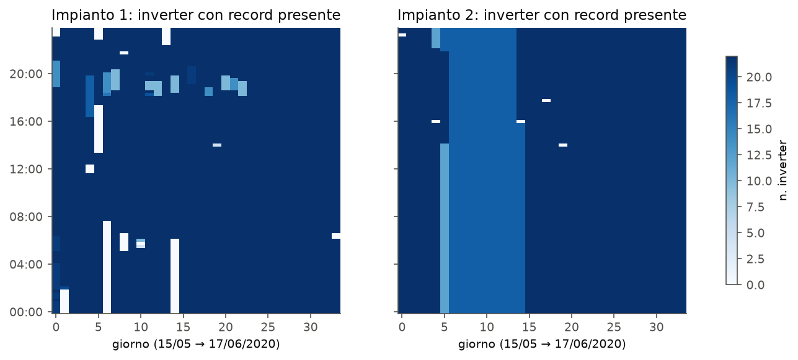
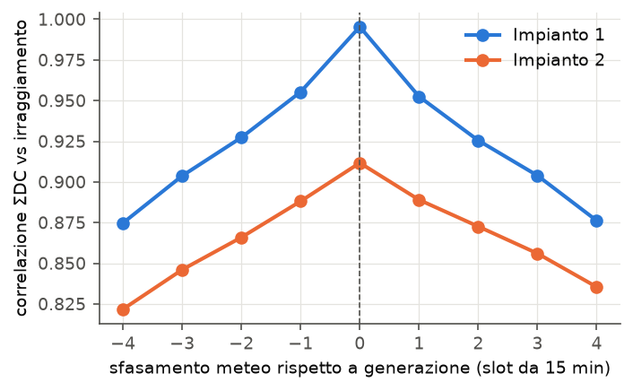
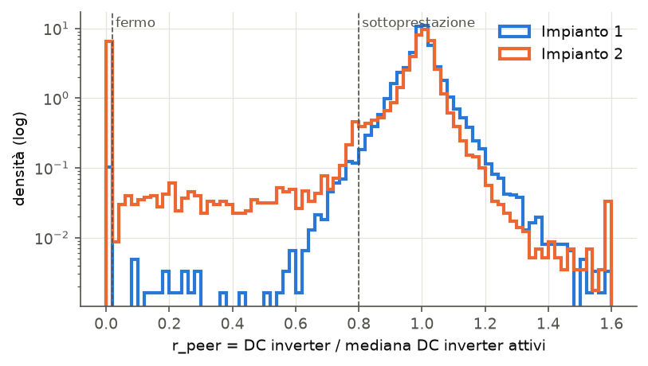
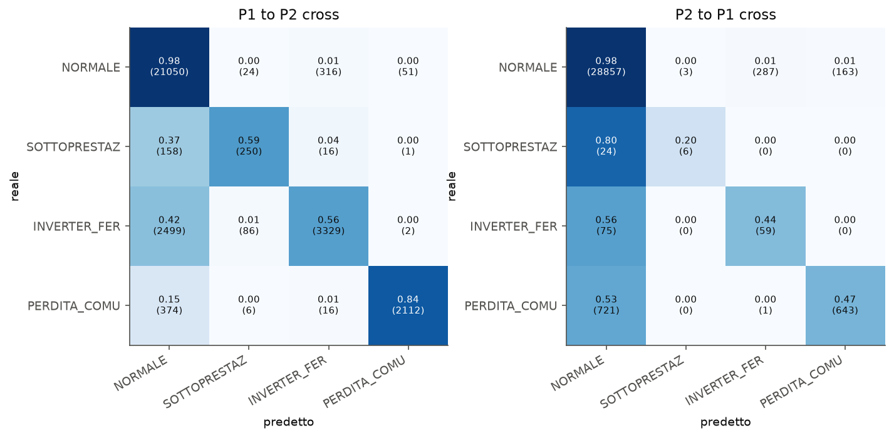

# Bozza v0.1: pulizia dei dati, metrica cross-impianto e confronto con la letteratura

> **Stato:** bozza di lavoro da rivedere e riscrivere con parole mie prima della consegna.
> Tutti i numeri sono generati da `python scripts/run_experiments.py`
> (tabelle complete in `results/summary.md`, dettagli in `results/*.json`).
> I punti marcati **[TODO]** sono lavoro ancora da fare; quelli marcati **[VERIFICARE]** sono
> riferimenti bibliografici da controllare sul testo originale prima di citarli.

---

## 0. Il dataset e il sistema beta in breve

**Dataset.** Kaggle, *Solar Power Generation Data* (A. Kannal). Contiene dati di due impianti
fotovoltaici in India raccolti per 34 giorni (15/05–17/06/2020) a intervalli di 15 minuti.
La descrizione colloca gli impianti vicino a Gandikota (Andhra Pradesh) e Nasik (Maharashtra),
ma non dice quale sia l'impianto 1 e quale il 2. Per ogni impianto ci sono:

* un file di **generazione** a livello di inverter (22 inverter per impianto, identificati da `SOURCE_KEY`):
  `DC_POWER`, `AC_POWER` (kW), `DAILY_YIELD`, `TOTAL_YIELD` (kWh);
* un file **meteo** a livello di impianto, con un solo sensore:
  `AMBIENT_TEMPERATURE`, `MODULE_TEMPERATURE` (°C), `IRRADIATION` (kW/m², media sui 15 min).

La descrizione Kaggle propone tre usi: prevedere la produzione, capire quando pulire o manutenere i moduli,
e individuare apparecchiature guaste o che rendono meno del dovuto. **Il dataset non contiene etichette
di guasto.** È il vincolo metodologico più importante del lavoro, ripreso nella sezione 2.

**Architettura della beta** (codice in `pv_fault/`):

```
CSV SCADA ──► pulizia (data_cleaning.py) ──► etichette a regole (labeling.py)
                                             │  confronto tra inverter "peer"
                                             ▼
                      gemello digitale (models.py): potenza attesa da meteo + ora
                                             ▼
          feature adimensionali (features.py) ──► sistema ibrido (models.py)
             • stato attuale anomalo  → persistenza
             • stato attuale normale  → LightGBM stima il rischio di INSORGENZA
               di un guasto nelle prossime 2 ore (4 classi)
                                             ▼
          raccomandazioni (recommendations.py) ──► sito Flask (webapp/)
```

Le classi a livello di inverter sono NORMALE, SOTTOPRESTAZIONE, INVERTER_FERMO e PERDITA_COMUNICAZIONE.
Due diagnosi a livello di impianto (sensore meteo sospetto, stress termico) sono calcolate solo con regole.

---

## 1. Gestione della pulizia dei dati

### 1.1 Problemi trovati e come sono stati trattati

| # | Problema | Evidenza (Imp. 1 / Imp. 2) | Trattamento | Motivazione |
|---|---|---|---|---|
| 1 | Formati data diversi | `15-05-2020 00:00` vs `2020-05-15 00:00:00` | parsing con formato esplicito per file | l'inferenza automatica può scambiare giorno e mese nei giorni ≤ 12 |
| 2 | `DC_POWER` dell'impianto 1 in scala ×10 | mediana AC/DC = **0.098** / 0.978 | DC_1 × 0.1 (fattore stimato in automatico) | un rendimento del 10 % è fisicamente impossibile. Dopo la correzione i due impianti hanno k = 1551 e 1583 kW per kW/m², quindi valori coerenti |
| 3 | Timestamp fuori griglia o duplicati | 0 / 0 | arrotondamento a 15 min e media dei duplicati (controllo mantenuto per i dati caricati) | robustezza su dati SCADA reali |
| 4 | Slot senza **nessun** record di generazione | **106** / 5 su 3264 | griglia completa timestamp × inverter (71 808 righe) | i buchi devono essere visibili, non "saltati" |
| 5 | Slot meteo mancanti | **82** / 5 | irraggiamento = 0 negli slot notturni. Interpolazione temporale solo per buchi ≤ 1 h. Temperature interpolate anche su buchi lunghi, ma solo se interamente notturni. Il resto (**27** slot, imp. 1) resta NaN ed è escluso | di notte l'irraggiamento è noto (0), di giorno un buco lungo non è ricostruibile senza inventare nuvole |
| 6 | Griglie meteo e generazione non coincidenti | 1 slot generazione senza meteo, 25 slot meteo senza generazione / 0 e 0 | join esatto sulla griglia comune dopo il reindex. Gli slot rimasti senza meteo non entrano nel training | è la "discrepanza di campionamento" vera: le griglie hanno lo stesso passo ma buchi diversi |
| 7 | Possibile sfasamento di orologio tra i due sistemi di acquisizione | correlazione ΣDC–irraggiamento massima a **lag 0** (0.995 / 0.912, vedi fig. 2) | nessuno shift (il codice lo applicherebbe se il massimo cadesse a lag ≠ 0) | verifica esplicita invece di assumere la sincronizzazione |
| 8 | Record di inverter mancanti di notte | 2165 / 1868 righe | potenza = 0 | di notte la produzione è 0 per definizione: il dato mancante non è un guasto |
| 9 | Record di inverter mancanti di giorno | **865** (704 dei quali con l'intero impianto muto) / **2242** | nessuna imputazione: etichetta PERDITA_COMUNICAZIONE | imputare la potenza creerebbe finti "normali" o finti "guasti". Nell'imp. 2, **4 inverter mancano per ~9 giorni** (fig. 1) |
| 10 | Contatori incoerenti | TOTAL_YIELD con **1161** decrementi e 563 zeri (imp. 2). DAILY_YIELD non si azzera a mezzanotte (69 % dei casi nell'imp. 2) | contatori **esclusi dalle feature**. Usati solo come controllo: ΔDAILY_YIELD / (AC·0.25 h) = 0.99 | la potenza istantanea è coerente con l'energia, i contatori cumulativi no |
| 11 | Plausibilità fisica | AC > DC in 18 / 17 righe. Nessun valore negativo, nessun irraggiamento > 1.5 kW/m² | righe mantenute ma conteggiate | quantità trascurabili (< 0.03 %) |
| 12 | DC = 0 con irraggiamento ≥ 0.1 kW/m² | **63** / **3774** righe | **non** è un errore di dato: è il segnale di guasto (INVERTER_FERMO) | distinguere "dato sporco" da "evento da prevedere" |


*Fig. 1: numero di inverter con un record presente, per giorno e ora del giorno (dato grezzo).*


*Fig. 2: correlazione tra potenza DC d'impianto e irraggiamento al variare dello sfasamento.*

### 1.2 Normalizzazione tra impianti

Per usare lo stesso modello su impianti di taglia diversa tutte le grandezze sono rese adimensionali:

* `k_plant` = mediana tra gli inverter del 95° percentile di DC/irraggiamento con sole pieno (> 0.3 kW/m²);
* `P_NORM = DC / k_plant`, cioè l'"irraggiamento equivalente" dell'inverter;
* `r_peer = DC_i / mediana(DC degli inverter attivi nello stesso istante)`.

`k_plant` si calcola dai dati del nuovo impianto **senza etichette** (calibrazione non supervisionata).
È l'unica informazione sull'impianto di test che il sistema usa.

### 1.3 Etichette (weak supervision)

Senza etichette reali, le classi sono derivate con regole trasparenti sul solo `r_peer`
(soglie in `pv_fault/config.py`, distribuzione in fig. 3):

* INVERTER_FERMO: r_peer < 0.02 per almeno 30 min;
* SOTTOPRESTAZIONE: 0.02 ≤ r_peer < 0.80 per almeno 45 min. La persistenza serve a non scambiare per guasto
  una nuvola che copre solo una parte del campo;
* PERDITA_COMUNICAZIONE: record mancante in un istante diurno.

Il confronto tra pari **non usa il sensore meteo e non usa il modello ML**, quindi non c'è circolarità
tra chi crea le etichette e chi viene valutato. Il limite è che un degrado uniforme di tutti gli inverter
non viene visto. Per quel caso servono il gemello digitale e le diagnosi a livello di impianto.

| Slot diurni per classe | Impianto 1 | Impianto 2 |
|---|---:|---:|
| NORMALE | 30 653 | 24 828 |
| SOTTOPRESTAZIONE | 9 | 370 |
| INVERTER_FERMO | 60 | 3 620 |
| PERDITA_COMUNICAZIONE | 865 | 2 242 |


*Fig. 3: distribuzione di r_peer. L'impianto 2 ha una massa enorme a 0 (inverter fermi) e una coda di sottoprestazione.*

**Osservazione importante per la tesi:** i due impianti sono molto diversi. L'impianto 1 è quasi "sano"
(0.2 % di slot guasti elettrici), l'impianto 2 ha il 13 % di slot guasti. Questo spostamento della
distribuzione delle classi (*prior shift*) domina i risultati cross-impianto.

**[TODO]** Analisi di sensibilità delle soglie (UNDER_RATIO 0.75/0.80/0.85, persistenza 30/45/60 min).

---

## 2. Metrica di valutazione nei test su impianto incrociato

### 2.1 Protocollo

| Scenario | Training | Test |
|---|---|---|
| P1_temporale | primi 24 giorni imp. 1 | ultimi 10 giorni imp. 1 |
| P2_temporale | primi 24 giorni imp. 2 | ultimi 10 giorni imp. 2 |
| **P1→P2** | tutto imp. 1 | tutto imp. 2 |
| **P2→P1** | tutto imp. 2 | tutto imp. 1 |

* Split **temporale** e mai casuale: con campioni a 15 min uno split casuale mette nel test istanti
  adiacenti a quelli di training, e i risultati diventano ottimistici. Tra training e test c'è un
  intervallo pari all'orizzonte (2 h), così il target del training non si sovrappone al test.
* Nessun iperparametro è scelto guardando l'impianto di test. Le varianti del modello (set di feature,
  pesi di classe, sistema ibrido o no) sono state confrontate **solo sugli scenari temporali**.
* Feature solo adimensionali: niente potenze assolute. Sono escluse anche le temperature assolute,
  che descrivono il clima del sito più che lo stato dell'inverter.

### 2.2 Metriche scelte e perché

| Compito | Metrica primaria | Metriche di supporto | Perché |
|---|---|---|---|
| Gemello digitale (potenza attesa) | **nRMSE** = RMSE / media misurata | R², MAE | adimensionale, quindi confrontabile tra impianti di taglia diversa |
| Stato a +2 h (4 classi) | **macro-F1** e **MCC**, sempre affiancati alla **baseline di persistenza** e allo skill score (M − M_pers)/(1 − M_pers) | recall per classe, matrice di confusione | la macro-F1 pesa le classi rare quanto la classe normale. L'MCC resta informativo anche con classi molto sbilanciate |
| Insorgenza di un nuovo guasto | **Average Precision (AUC-PR)** confrontata con la **prevalenza** (lift = AP / prevalenza) | precision, recall e MCC alla soglia argmax | non dipende dalla soglia e rende conto del prior shift. Un classificatore casuale ha AP = prevalenza |

**Perché non l'accuratezza.** Nello scenario P2→P1 il sistema ha accuratezza **0.959**, ma un
classificatore che risponde sempre "NORMALE" arriva a 0.950 (29 310 / 30 839). La macro-F1 dello
stesso sistema è 0.531. Studi che riportano solo l'accuratezza su dati sbilanciati non sono confrontabili.

**Perché la baseline di persistenza.** Nei dati un guasto dura in media ore. Prevedere a 2 ore
"succederà ciò che succede adesso" è quindi già molto efficace, e un modello è utile solo se fa meglio.

### 2.3 Risultati

**Gemello digitale** (righe NORMALI dell'impianto di test):

| Scenario | LightGBM nRMSE / R² | Fisico P = a·G·(1−0.004·(Tmod−25)) nRMSE / R² |
|---|---:|---:|
| P1_temporale | 8.5 % / 0.967 | 8.8 % / 0.965 |
| P2_temporale | 28.4 % / 0.707 | 28.1 % / 0.713 |
| P1→P2 | 25.1 % / 0.769 | 25.4 % / 0.763 |
| P2→P1 | 16.3 % / 0.879 | **11.9 % / 0.936** |

Il modello fisico a un parametro **trasferisce meglio** del LightGBM quando si addestra sull'impianto 2
(P2→P1). Il LightGBM impara relazioni specifiche del sito. L'impianto 2 resta difficile anche in-sito
(nRMSE 28 %): con un solo sensore di irraggiamento per 22 inverter, la variabilità spaziale delle nuvole
non è osservabile. Ne segue un'indicazione progettuale: modello fisico come base e ML solo sul residuo.

**Stato a +2 h, 4 classi:**

| Scenario | Ibrido macro-F1 / MCC | Persistenza macro-F1 / MCC |
|---|---:|---:|
| P1_temporale | 0.671 / 0.498 | 0.765 / 0.646 |
| P2_temporale | 0.453 / 0.613 | 0.693 / 0.658 |
| P1→P2 | 0.789 / 0.731 | 0.789 / 0.732 |
| P2→P1 | 0.531 / 0.515 | 0.600 / 0.591 |

**Onestamente: sullo stato a 2 ore il sistema ibrido non batte la persistenza.** Nel caso migliore
(P1→P2) la eguaglia, negli altri è peggiore per via dei falsi allarmi sugli istanti normali.

**Insorgenza di nuovi guasti elettrici** (inverter oggi normali che si fermeranno o
andranno in sottoprestazione entro 2 h). Qui la persistenza, per costruzione, non prevede nulla:

| Scenario | Eventi | Prevalenza | AP | Lift | Recall @argmax |
|---|---:|---:|---:|---:|---:|
| P1_temporale | 24 | 0.003 | 0.102 | 37.8 | 0.00 |
| P2_temporale | 648 | 0.086 | 0.281 | 3.3 | 0.33 |
| P1→P2 | 2 500 | 0.109 | 0.251 | **2.3** | 0.01 |
| P2→P1 | 104 | 0.004 | 0.012 | **3.5** | 0.09 |

Sull'insorgenza c'è un segnale reale anche cross-impianto: il **ranking** del rischio è 2–3.5 volte
migliore del caso. Alla soglia di default però il modello addestrato sull'impianto 1 non lancia quasi
mai allarmi sull'impianto 2 (recall 1 %). Ha imparato un mondo in cui i guasti sono rarissimi (0.3 %) e le
sue probabilità sono tarate su quel mondo. **Per il cross-impianto la metrica primaria che propongo è quindi
l'AUC-PR con il lift sulla prevalenza**, indipendente dalla soglia. La soglia va trattata come un problema
separato di calibrazione, ad esempio con un "budget di allarmi" (top-k inverter per giorno) oppure
ricalibrando le probabilità con pochi giorni etichettati del nuovo impianto.


*Fig. 5: matrici di confusione cross-impianto (normalizzate per riga).*

### 2.4 Limiti che dichiaro

* Le etichette sono derivate da regole: il sistema è valutato sulla capacità di anticipare stati definiti
  dalle regole, non guasti confermati da un tecnico. **[TODO]** Se possibile, validare con un registro
  interventi o allarmi reale (anche di un impianto diverso).
* Nell'impianto 1 gli eventi di insorgenza nel test temporale sono solo 24: il lift di 37.8 è
  statisticamente fragile. **[TODO]** Intervalli di confidenza con bootstrap a blocchi giornalieri.
* 34 giorni di una sola stagione: nessuna informazione su monsone, sporcamento stagionale o degrado.
* **[TODO]** Tuning degli iperparametri con `TimeSeriesSplit` sul solo impianto sorgente, orizzonte day-ahead,
  calibrazione delle probabilità.

---

## 3. Confronto con risultati ottenuti in applicazioni simili

> **[VERIFICARE]** Non ho ancora letto tutti i testi completi. I valori sotto sono presi da abstract
> e schede degli articoli e vanno controllati sull'originale prima di citarli.

| Studio | Dati | Compito | Risultato dichiarato | Confrontabilità con questo lavoro |
|---|---|---|---|---|
| Ibrahim, Alsheikh, Awaysheh, Alshehri, *Machine Learning Schemes for Anomaly Detection in Solar Power Plants*, Energies 15(3):1082, 2022 | stesso dataset Kaggle **[VERIFICARE]** | anomalie con AE-LSTM, Prophet, Isolation Forest, poi classificatori supervisionati | AE-LSTM migliore. KNN, SVC ed ExtraTrees con accuratezza > 97 % | stesso dataset ma valutazione in-sito e con accuratezza. Anche qui l'accuratezza è 0.96–0.99, mentre la macro-F1 racconta un'altra storia (sez. 2.2) |
| Kalra, Beniwal, Singh, Beniwal, *Innovative Approaches in Residential Solar Electricity: Forecasting and Fault Detection Using ML*, Electricity 5(3), 2024 | **[VERIFICARE dataset]** | previsione della potenza da meteo e inquinamento, rilevazione guasti | R² = 0.95 in previsione | confrontabile col gemello digitale in-sito (R² 0.967 imp. 1). Non è una valutazione cross-impianto |
| Notebook pubblici Kaggle/GitHub sul dataset | imp. 1 | regressione di DC_POWER | R² ≈ 0.99 (regressione lineare, Random Forest) | di solito split casuale su campioni a 15 min (leakage temporale) e senza correzione della scala DC. Il mio R² temporale è 0.967 |
| Bommes et al., *Anomaly detection in IR images of PV modules using supervised contrastive learning*, arXiv:2112.02922 (2022) | 4 impianti, immagini IR | rilevazione anomalie **addestrando su un impianto e testando su un altro** | AUROC 73.3 %–96.6 % su 9 combinazioni sorgente→destinazione | modalità diversa (immagini), ma è uno dei pochi lavori con protocollo cross-impianto esplicito. Mostra lo stesso fenomeno: le prestazioni calano e variano molto con la coppia di impianti |
| Feng et al., *SunDown: Model-driven Per-Panel Solar Anomaly Detection for Residential Arrays*, ACM TCPS 2021 **[VERIFICARE autori]** | impianti residenziali, dati per pannello | rilevazione e classificazione di guasti con confronto tra pannelli vicini | 99.13 % di accuratezza su guasti singoli, 97.2 % su guasti concorrenti | stessa idea del mio `r_peer` (confronto tra pari invece del sensore meteo). È **rilevazione** del guasto in corso, non previsione, e i guasti sono in parte simulati |
| UTS / Diagno Energy / UNSW (2026), rilevazione di sottoprestazione con soli dati AC dell'inverter (riportato da pv-magazine) | inverter residenziali, 5 min | classificazione del tipo di sottoprestazione | 92 % di accuratezza | classi simili (trip a zero, clipping, sottoprestazione ricorrente). **[TODO]** trovare l'articolo scientifico originale |
| Livera, Theristis, Makrides, Georghiou, *Recent advances in failure diagnosis techniques based on performance data analysis for grid-connected PV systems*, Renewable Energy, 2019 **[VERIFICARE]** | review | tassonomia dei metodi di diagnosi basati sui dati di prestazione | nessun numero | utile per l'inquadramento nel capitolo di stato dell'arte |

**Messaggio del confronto:** in letteratura le prestazioni riportate sono molto alte (accuratezza
92–99 %, R² 0.95–0.99), ma quasi sempre sono misurate **nello stesso impianto**, con split casuali e
con l'accuratezza su classi sbilanciate. Con un protocollo più severo (split temporale, test su un altro
impianto, baseline di persistenza, macro-F1, MCC e AUC-PR) i numeri di questo lavoro sono più bassi, ma
sono più vicini a quello che succederebbe installando il sistema su un impianto nuovo. L'unico studio
cross-impianto trovato finora (Bommes et al.) conferma il calo e la forte variabilità tra coppie di impianti.

**[TODO]** Cercare lavori con test cross-impianto su dati SCADA (non immagini) e verificare se
esistono studi che usano il dataset Kaggle con split temporale.

---

## 4. Proposta di indice dei primi capitoli (da scrivere)

1. **Introduzione**: O&M del fotovoltaico, costo dei guasti non rilevati, obiettivi della tesi.
2. **Guasti negli impianti FV**: tassonomia (moduli, stringhe, inverter, comunicazione, sensori), sintomi nei dati SCADA, riferimento IEC 61724-1 per il monitoraggio.
3. **Stato dell'arte**: metodi fisici, basati sui dati e ibridi. Rilevazione vs previsione. Il problema della generalizzazione tra impianti (sezione 3 di questa bozza).
4. **Dati e pre-elaborazione**: sezione 1 di questa bozza.
5. **Metodologia**: etichette weak-supervised, gemello digitale, sistema ibrido, protocollo di valutazione (sezione 2).
6. *(successivi)* Risultati, sito web, discussione, conclusioni.

---

## Come riprodurre

```bash
pip install -r requirements.txt
python scripts/run_experiments.py     # ~30 s, rigenera results/ e models/
python webapp/app.py                  # sito beta su http://127.0.0.1:5000
```
