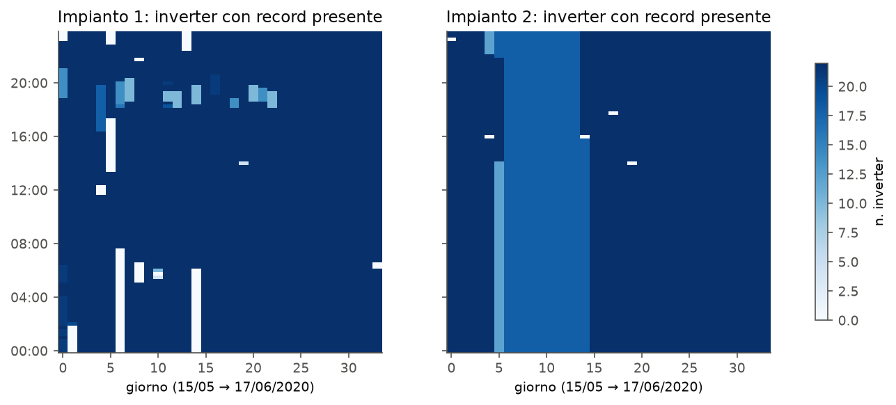
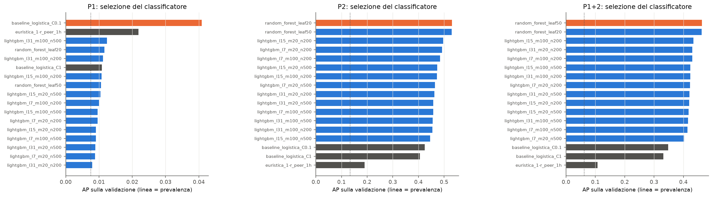
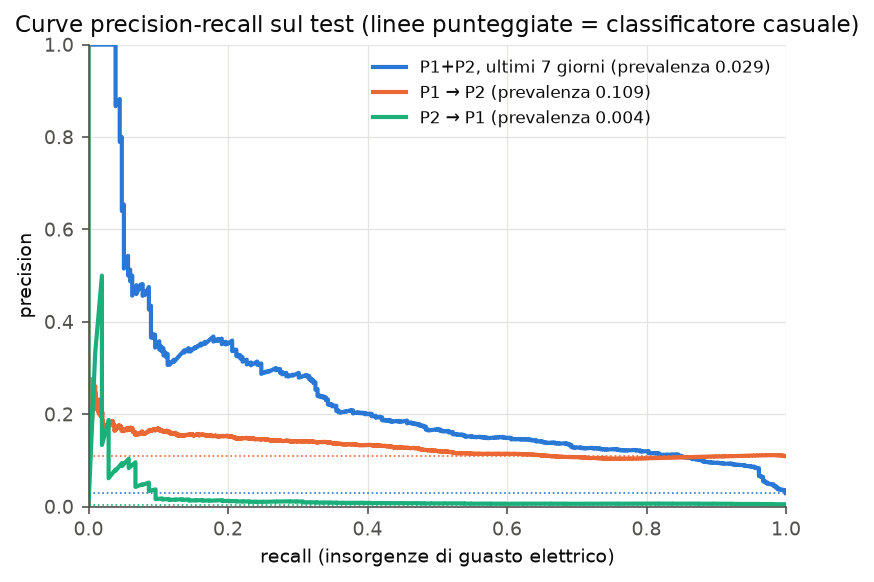
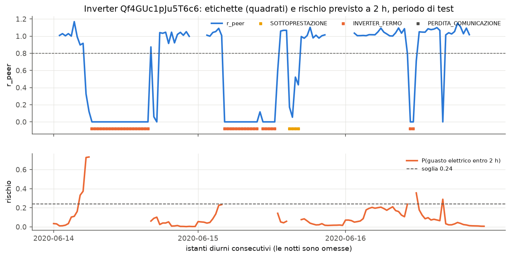
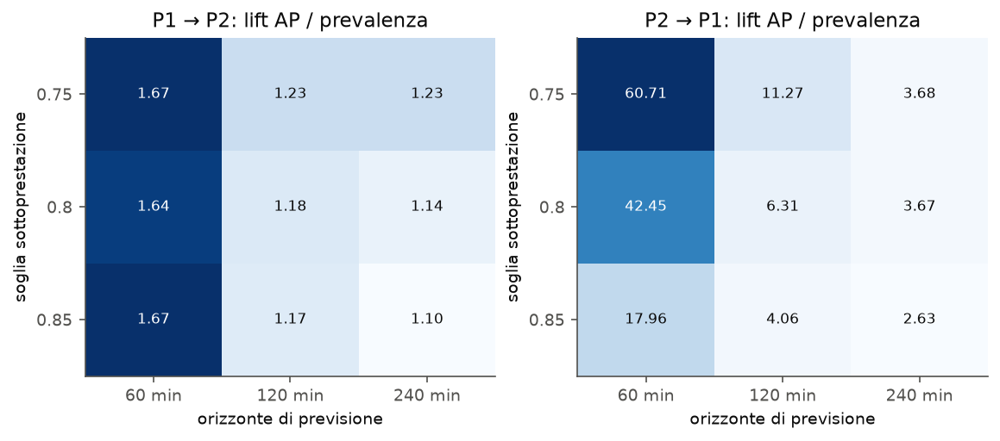
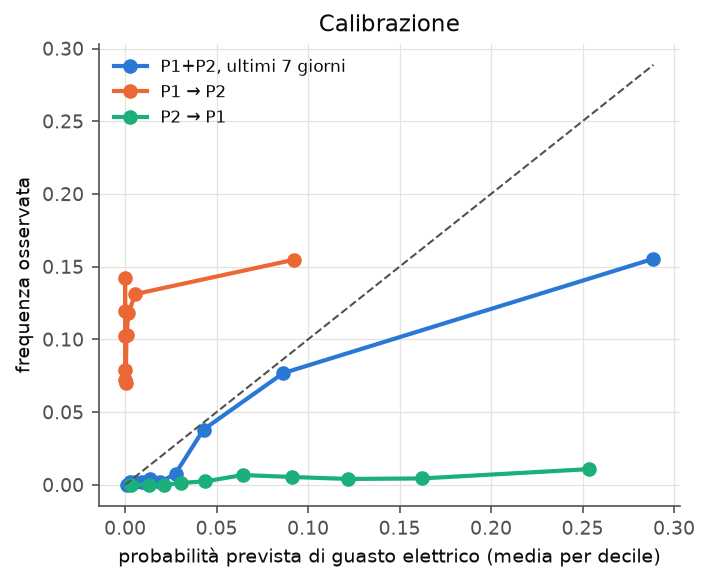

# Previsione di guasti in impianti fotovoltaici: prima versione del modello

Questa relazione descrive la prima versione del sistema: i dati, la pulizia, l'addestramento, la
validazione e il test del modello. Le tabelle complete sono in `results/summary.md` e si rigenerano
con `python scripts/run_experiments.py`.

## 1. Dati

Il dataset Kaggle "Solar Power Generation Data" contiene i dati di due impianti fotovoltaici in India
(dalla descrizione: vicino a Gandikota, Andhra Pradesh, e a Nasik, Maharashtra; non è indicato quale
sia l'impianto 1 e quale il 2) dal 15 maggio al 17 giugno 2020, con un campione ogni 15 minuti.
Per ogni impianto ci sono due file:

- generazione, per ciascuno dei 22 inverter: DC_POWER e AC_POWER in kW, DAILY_YIELD e TOTAL_YIELD in kWh;
- meteo, un solo sensore per impianto: temperatura ambiente, temperatura dei moduli e irraggiamento (kW/m²).

Il dataset non contiene etichette di guasto. Questa è la scelta di metodo più importante del lavoro
ed è descritta nella sezione 3.

## 2. Pulizia dei dati

| Problema | Impianto 1 | Impianto 2 | Come è stato trattato |
|---|---:|---:|---|
| Formato data | `dd-mm-YYYY HH:MM` | ISO | lettura con formato esplicito per ogni file, per non scambiare giorno e mese |
| Rapporto AC/DC mediano | 0.098 | 0.978 | DC_POWER dell'impianto 1 moltiplicato per 0.1: un rendimento del 10 % non è fisicamente possibile |
| Istanti senza alcun dato di generazione (su 3264) | 106 | 5 | griglia completa timestamp × inverter (71 808 righe per impianto) |
| Istanti meteo mancanti | 82 | 5 | irraggiamento a 0 di notte; interpolazione solo per buchi fino a 1 ora; 27 istanti dell'impianto 1 restano mancanti e sono esclusi |
| Istanti presenti solo in uno dei due file | 1 + 25 | 0 | unione esatta sulla griglia comune |
| Sfasamento tra meteo e produzione | lag 0 (corr. 0.995) | lag 0 (corr. 0.912) | nessuna correzione; il controllo resta nel codice |
| Record di inverter mancanti di notte | 2 165 | 1 868 | potenza a 0 |
| Record di inverter mancanti di giorno | 865 | 2 242 | nessuna imputazione: diventano PERDITA_COMUNICAZIONE (nell'impianto 2 quattro inverter mancano per circa 9 giorni) |
| TOTAL_YIELD che diminuisce | 0 | 1 161 | contatori esclusi dalle feature |
| DC = 0 con irraggiamento ≥ 0.1 kW/m² | 63 | 3 774 | non è un errore nei dati ma il guasto da prevedere |

La potenza istantanea è coerente con l'energia: l'incremento di DAILY_YIELD in 15 minuti vale circa
0.99 volte AC_POWER × 0.25 h. I contatori cumulativi, invece, non sono affidabili.

Per confrontare impianti di taglia diversa, la potenza è divisa per `k`, cioè la potenza tipica di un
inverter per unità di irraggiamento (95° percentile di DC/irraggiamento con sole pieno, mediana tra
gli inverter). Si ottiene k = 1551 per l'impianto 1 e k = 1583 per l'impianto 2. Il valore si stima
dai dati del nuovo impianto e non richiede etichette.

## 3. Etichette

Ogni inverter viene confrontato con la mediana degli inverter attivi dello stesso impianto nello stesso
istante:

r_peer = DC dell'inverter / mediana DC degli inverter attivi

- INVERTER_FERMO: r_peer < 0.02 per almeno 30 minuti;
- SOTTOPRESTAZIONE: 0.02 ≤ r_peer < 0.80 per almeno 45 minuti (la durata minima evita di scambiare
  per guasto una nuvola che copre solo una parte del campo);
- PERDITA_COMUNICAZIONE: record mancante di giorno.

Le regole non usano il sensore di irraggiamento né il modello che viene valutato. Il limite è che un
calo comune a tutti gli inverter non viene etichettato.

| Istanti diurni per classe | Impianto 1 | Impianto 2 |
|---|---:|---:|
| NORMALE | 30 653 | 24 828 |
| SOTTOPRESTAZIONE | 9 | 370 |
| INVERTER_FERMO | 60 | 3 620 |
| PERDITA_COMUNICAZIONE | 865 | 2 242 |

I due impianti sono molto diversi. L'impianto 1 è quasi privo di guasti elettrici (0.2 % degli istanti),
l'impianto 2 ne ha il 13 %. Questo pesa molto sui test tra impianti.

## 4. Modello

Il sistema ha due parti.

1. Lo stato attuale di ogni inverter viene dalle regole della sezione 3. Se un inverter è già in
   guasto, la previsione a 2 ore è che resti in quello stato.
2. Per gli inverter in stato normale, un classificatore stima la probabilità che nelle 2 ore successive
   compaia una SOTTOPRESTAZIONE o un INVERTER_FERMO (insorgenza di un guasto elettrico). Sopra una
   soglia si genera un allarme.

Le feature (21) sono tutte adimensionali o fisiche. Comprendono la storia di r_peer nell'ultima ora,
nelle ultime 2 ore e nelle ultime 24 ore, il numero di eventi anomali nelle 24 ore precedenti, lo
scarto rispetto al gemello digitale, irraggiamento e sua variazione, differenza tra temperatura dei
moduli e ambiente, ora del giorno e quota di inverter dell'impianto già in guasto. Le potenze assolute
e le temperature assolute sono escluse, perché legano il modello a un impianto e a un clima specifici.

Il gemello digitale stima la potenza normalizzata attesa dati irraggiamento, temperatura dei moduli e
ora. I candidati sono tre: un modello fisico P = a·G·(1 − 0.004·(Tmod − 25)) + b, LightGBM, e il
modello fisico con LightGBM sul residuo.

I classificatori candidati sono 16: regressione logistica (2 valori di regolarizzazione), random forest
(2 valori di foglia minima) e LightGBM (12 combinazioni di foglie, campioni minimi per foglia e numero
di alberi). Come riferimento senza apprendimento c'è anche l'euristica "rischio = 1 − r_peer medio
dell'ultima ora".

## 5. Protocollo di addestramento, validazione e test

| Periodo | Giorni | Uso |
|---|---|---|
| Train | 15/05–03/06 (20) | addestramento |
| Validazione | 04/06–10/06 (7) | scelta del gemello, del classificatore e della soglia d'allarme |
| Test | 11/06–17/06 (7) | valutazione finale, usato una sola volta |

Lo split è per giorni e mai casuale: con campioni ogni 15 minuti, uno split casuale metterebbe nel test
istanti quasi identici a quelli di training. Le ultime 2 ore di ogni periodo sono escluse, così il
target non sconfina nel periodo successivo.

Gli scenari valutati sono:

- P1, P2 e P1+P2: train e validazione sugli stessi impianti, test sugli ultimi 7 giorni.
  P1+P2 è la configurazione del modello finale.
- P1→P2 e P2→P1: scelta del modello sulla validazione dell'impianto sorgente, addestramento su tutti i
  suoi 34 giorni, test su tutti i 34 giorni dell'altro impianto.

Il modello finale usa la configurazione scelta sulla validazione P1+P2 (gemello fisico, random forest
con foglia minima 50, soglia 0.238) ed è riaddestrato su tutti i dati dei due impianti.

## 6. Metriche

- Insorgenza di guasti elettrici, la metrica principale: average precision (area sotto la curva
  precision-recall), confrontata con la prevalenza. Un classificatore casuale ha AP uguale alla
  prevalenza; il rapporto tra le due ("lift") rende confrontabili scenari con prevalenze diverse.
  Si riportano anche precision e recall alla soglia scelta in validazione.
- Eventi: un evento è l'inizio di un guasto elettrico preceduto da funzionamento normale. È anticipato
  se nelle 2 ore precedenti c'è stato almeno un allarme. Si riportano la quota di eventi anticipati,
  l'anticipo mediano e i falsi allarmi per inverter al giorno (gli allarmi consecutivi contano come uno).
- Stato a 2 ore (4 classi): macro-F1 e MCC, confrontati con la persistenza ("tra 2 ore l'inverter sarà
  nello stato attuale").
- Gemello digitale: nRMSE (RMSE diviso la potenza media misurata) e R².

L'accuratezza non è usata. Con oltre il 90 % di istanti normali, rispondere sempre "normale" darebbe
già un'accuratezza superiore a 0.9.

Gli intervalli di confidenza al 95 % sono calcolati con un bootstrap che ricampiona i giorni interi
(500 ripetizioni). I campioni dello stesso giorno sono correlati e ricampionarli singolarmente darebbe
intervalli troppo stretti.

## 7. Risultati

### 7.1 Selezione sulla validazione

Sulla validazione P2 e P1+P2 le random forest sono le migliori (AP 0.53 e 0.46). Seguono LightGBM
(fino a 0.50 e 0.43) e la regressione logistica (0.42 e 0.35). L'euristica si ferma a 0.19 e 0.11.

Sull'impianto 1 la validazione contiene solo 48 istanti positivi. Tutti i modelli hanno AP tra 0.008 e
0.04, con prevalenza 0.0075: la scelta su questo impianto è poco affidabile.

### 7.2 Insorgenza di guasti elettrici sul test

| Scenario | Prevalenza | AP [IC95] | Lift | AP euristica | Precision / Recall alla soglia |
|---|---:|---|---:|---:|---|
| P1+P2 (modello finale) | 0.029 | 0.238 [0.056–0.375] | 8.2 | 0.084 | 0.20 / 0.36 |
| P2 | 0.057 | 0.296 [0.069–0.437] | 5.2 | 0.105 | 0.19 / 0.49 |
| P1 | 0.004 | 0.082 [0.002–0.177] | 21.0 | 0.063 | 0.04 / 0.50 |
| P1→P2 | 0.109 | 0.129 [0.097–0.173] | 1.2 | 0.178 | 0.16 / 0.13 |
| P2→P1 | 0.004 | 0.022 [0.003–0.086] | 6.3 | 0.014 | 0.01 / 0.19 |

### 7.3 Eventi

| Scenario | Eventi | Anticipati | Anticipo mediano | Falsi allarmi / inverter·giorno |
|---|---:|---:|---:|---:|
| P1+P2 (modello finale) | 59 | 36 (61 %) | 60 min | 0.43 |
| P2 | 56 | 39 (70 %) | 90 min | 1.36 |
| P1 | 3 | 2 | 105 min | 0.96 |
| P1→P2 | 403 | 143 (35 %) | 30 min | 0.65 |
| P2→P1 | 15 | 11 (73 %) | 15 min | 0.88 |

Con un budget fisso di allarmi (il 2 % degli istanti a rischio più alto) il modello finale anticipa
33 eventi su 59 con 0.19 falsi allarmi per inverter al giorno.

### 7.4 Stato a 2 ore rispetto alla persistenza

| Scenario | Sistema macro-F1 | Persistenza macro-F1 | Differenza [IC95] |
|---|---:|---:|---|
| P1+P2 | 0.669 | 0.694 | −0.025 [−0.084, −0.001] |
| P2 | 0.627 | 0.698 | −0.072 [−0.332, −0.019] |
| P1 | 0.455 | 0.764 | −0.310 [−0.481, −0.087] |
| P1→P2 | 0.720 | 0.789 | −0.069 [−0.097, −0.048] |
| P2→P1 | 0.483 | 0.600 | −0.116 [−0.206, −0.048] |

Sulla classificazione dello stato a 2 ore il sistema è sempre un po' peggiore della persistenza. Gli
allarmi sugli inverter normali introducono falsi positivi, e i guasti, una volta iniziati, durano ore.
Il contributo del modello sta quindi nel segnalare in anticipo i guasti che stanno per iniziare, non
nel classificare quelli già in corso.

### 7.5 Gemello digitale

| Scenario | Fisico nRMSE / R² | LightGBM | Fisico + LightGBM |
|---|---|---|---|
| P1 test | 8.5 % / 0.967 | 8.0 % / 0.970 | 7.8 % / 0.972 |
| P2 test | 31.4 % / 0.624 | 31.3 % / 0.626 | 31.3 % / 0.627 |
| P1+P2 test | 20.5 % / 0.835 | 20.9 % / 0.828 | 20.6 % / 0.834 |
| P1→P2 | 25.4 % / 0.763 | 25.1 % / 0.769 | 25.1 % / 0.769 |
| P2→P1 | 11.9 % / 0.936 | 16.3 % / 0.879 | 14.1 % / 0.909 |

Sullo stesso impianto il ML migliora di poco il modello fisico. Passando dall'impianto 2 all'impianto 1,
il modello fisico si trasferisce molto meglio. Sull'impianto 2 l'errore resta alto anche con gli istanti
etichettati normali: con un solo sensore di irraggiamento per 22 inverter, il passaggio delle nuvole
sul campo non è osservabile.

### 7.6 Sensibilità

Cambiando la soglia di sottoprestazione (0.75, 0.80, 0.85) le conclusioni non cambiano. Allungando
l'orizzonte da 1 a 4 ore la prevalenza sale e il lift scende: prevedere più lontano è più difficile.

## 8. Discussione

- Il modello addestrato su entrambi gli impianti individua l'insorgenza dei guasti circa 8 volte meglio
  del caso e quasi 3 volte meglio dell'euristica. Anticipa il 61 % degli eventi con un'ora di anticipo
  mediano. L'intervallo di confidenza è però ampio (AP tra 0.06 e 0.37), perché nei 7 giorni di test
  ci sono solo 59 eventi.
- Il trasferimento tra impianti funziona male quando l'impianto di addestramento ha pochi guasti.
  Addestrato sull'impianto 1 (quasi sano), il modello è peggiore dell'euristica sull'impianto 2.
  Il caso opposto (P2→P1) mantiene un lift di 6, ma su soli 15 eventi.
- Le probabilità non si trasferiscono tra impianti con prevalenze diverse (fig. 5). La soglia scelta
  su un impianto produce sull'altro troppi o troppo pochi allarmi. Un budget fisso di allarmi è più
  stabile, ma richiede di accettare un certo numero di segnalazioni al giorno.

## 9. Confronto con altri lavori

I risultati in letteratura vanno letti con attenzione: quasi sempre sono ottenuti sullo stesso
impianto, con split casuali e riportando l'accuratezza. Valori di dettaglio e dataset vanno ancora
verificati sui testi originali.

| Lavoro | Dati e compito | Risultato riportato | Differenze rispetto a questo lavoro |
|---|---|---|---|
| Ibrahim et al., Energies 15(3):1082, 2022 | dataset Kaggle (da verificare), rilevazione di anomalie con AE-LSTM, Prophet, Isolation Forest e classificatori | accuratezza > 97 % | stesso impianto, accuratezza come metrica |
| Kalra et al., Electricity 5(3), 2024 | previsione della potenza e rilevazione di guasti (dataset da verificare) | R² = 0.95 | confrontabile con il gemello digitale (R² 0.97 su P1) |
| Notebook pubblici sul dataset | regressione di DC_POWER sull'impianto 1 | R² ≈ 0.99 | split casuale e scala DC non corretta |
| Bommes et al., arXiv:2112.02922, 2022 | immagini IR, addestramento su un impianto e test su un altro | AUROC 73–97 % su 9 coppie di impianti | dati diversi, ma stesso tipo di prova tra impianti: anche lì le prestazioni variano molto con la coppia |
| Feng et al., SunDown, ACM TCPS 2021 (autori da verificare) | rilevazione di guasti per pannello confrontando pannelli vicini | 99 % su guasti singoli | stessa idea del confronto tra pari, ma per rilevare guasti in corso, non per prevederli |
| Livera et al., Renewable Energy, 2019 (da verificare) | rassegna dei metodi di diagnosi basati sui dati di prestazione | — | inquadramento |

## 10. Limiti e prossimi passi

- Le etichette sono ricavate da regole e non da interventi reali di manutenzione. Servirebbe un
  registro degli allarmi o degli interventi per confermarle.
- 34 giorni in una sola stagione e pochi eventi nel test producono intervalli di confidenza ampi.
- La soglia d'allarme andrebbe ricalibrata su ogni nuovo impianto, ad esempio con pochi giorni di dati
  etichettati o con un budget di allarmi concordato con chi fa manutenzione.
- Prossime versioni: caricamento di nuovi CSV dal sito (il codice di pulizia e inferenza è già in
  `pv_fault/inference.py`) e analisi di descrizioni testuali.
